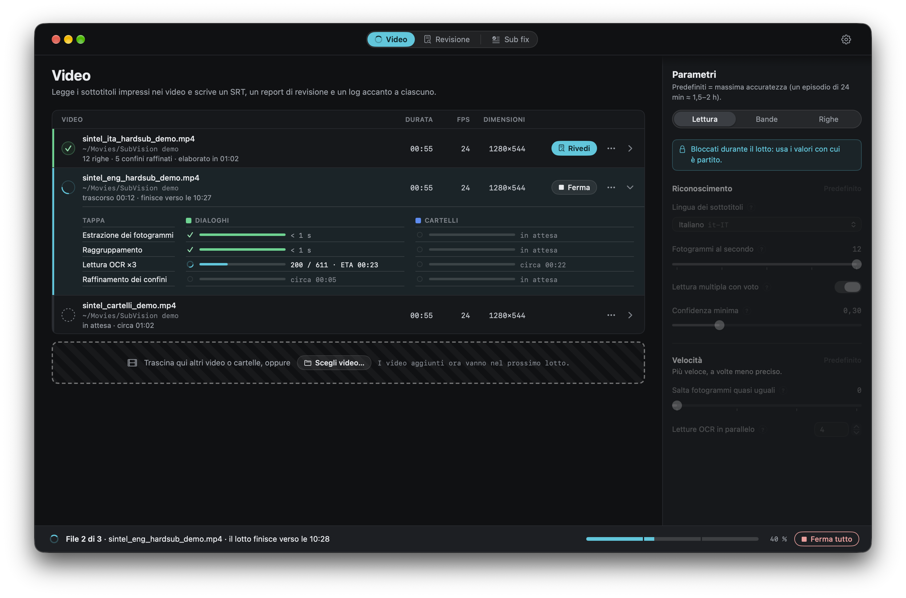
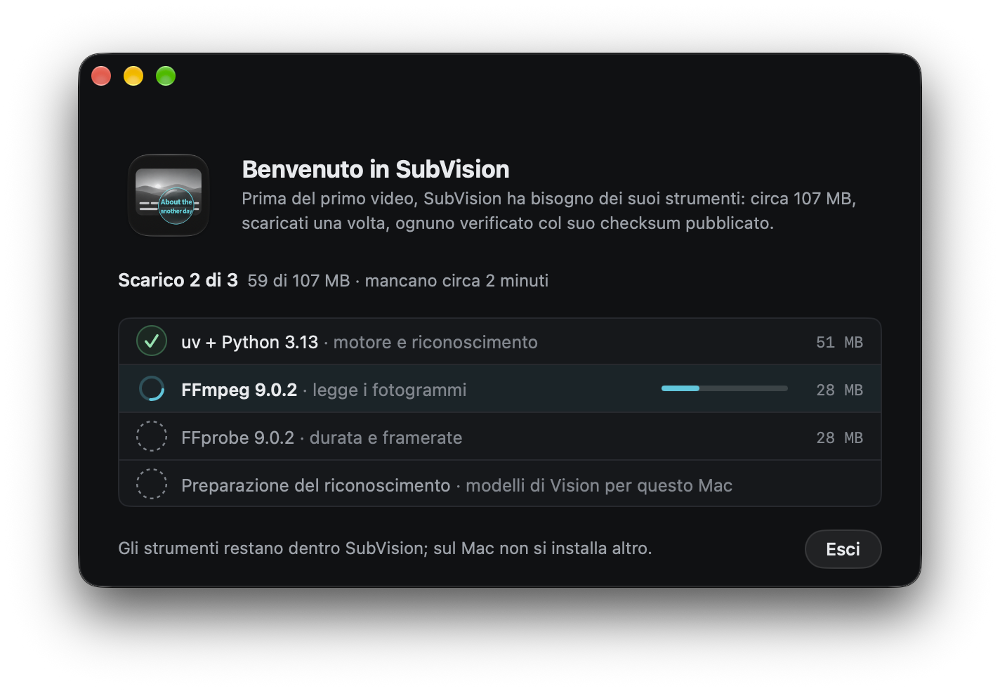
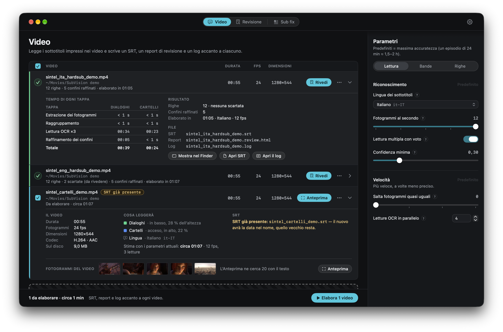
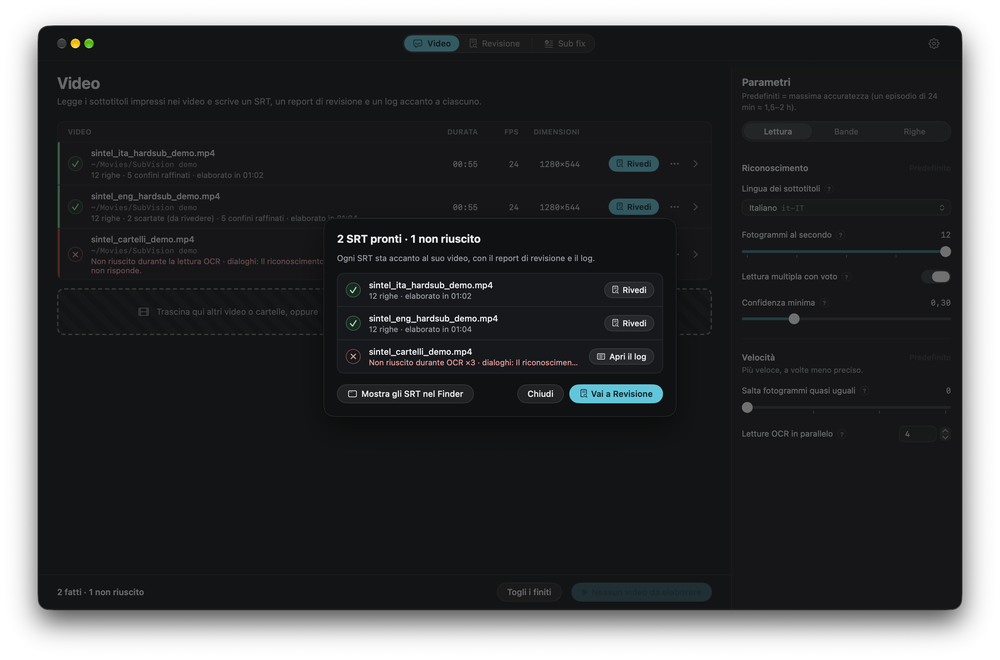
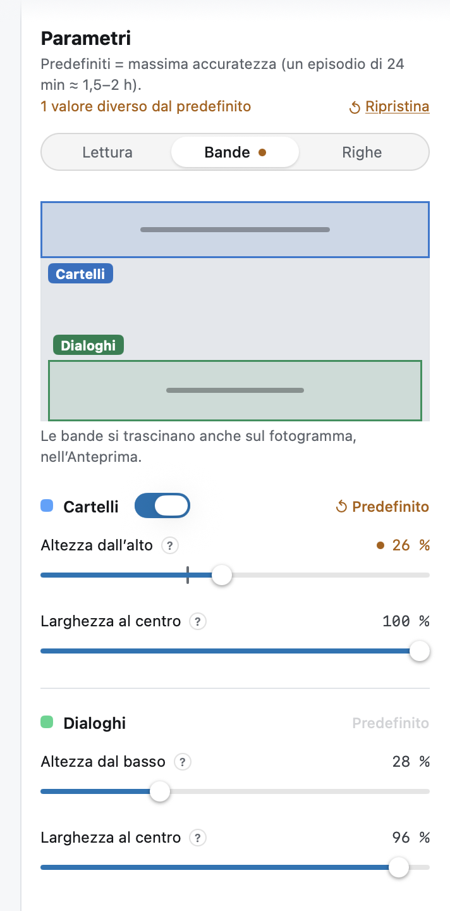
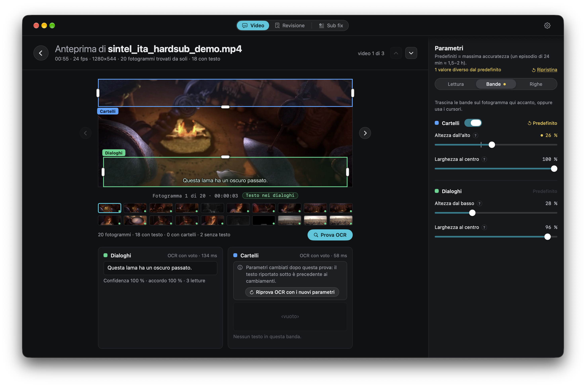
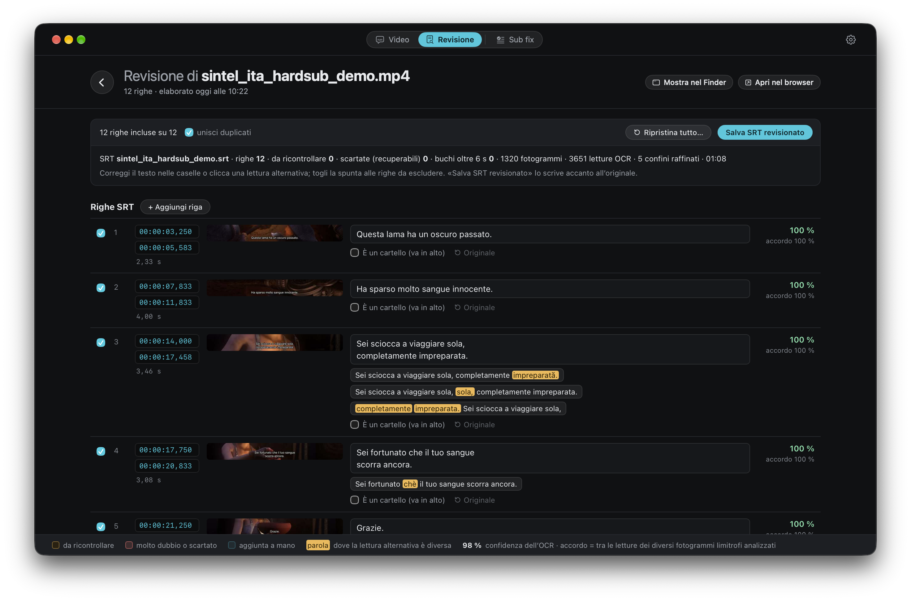
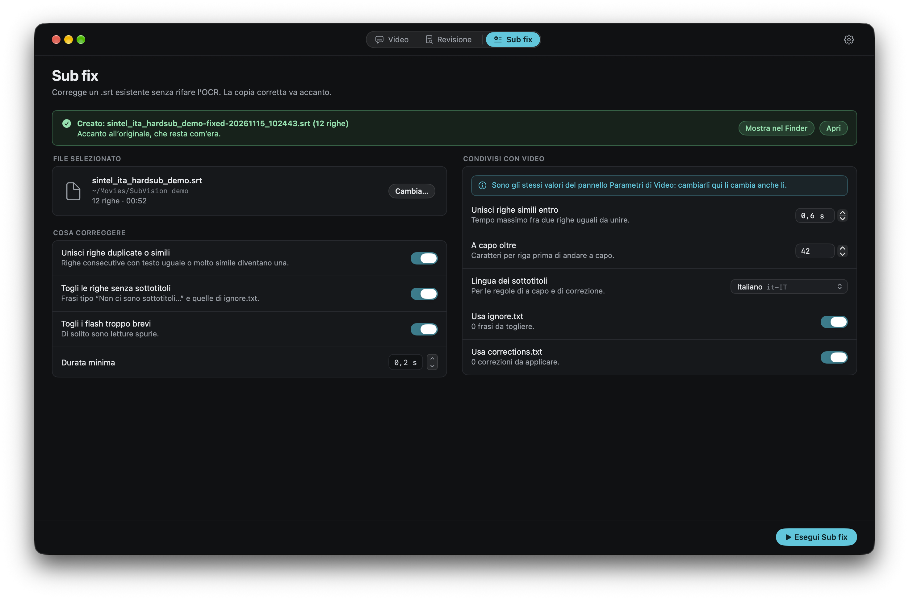

# SubVision


[🇬🇧 English](README.md) | 🇮🇹 Italiano


[](https://github.com/Interstellar0verdrive/SubVision/releases/latest)

**Estrae i sottotitoli impressi nei video e li trasforma in file SRT puliti,
con l'OCR di Apple. Un'app nativa per Mac: veloce, offline, niente
allucinazioni.**

SubVision legge i sottotitoli stampati nei fotogrammi di un video (hardsub) e
li trasforma in un `.srt` vero, con accanto un report di revisione dove
controllo e correggo le poche righe di cui l'OCR non era sicuro. È fatta per
**l'accuratezza prima di tutto**: i predefiniti privilegiano sempre la qualità
sulla velocità, così c'è il meno possibile da sistemare a mano.

<!-- TODO screenshot: video_dark_it.webp e video_light_it.webp, la pagina Video durante un lotto (vedi design/immagini-readme-2.0.md) -->
<picture>
  <source media="(prefers-color-scheme: light)" srcset="https://raw.githubusercontent.com/Interstellar0verdrive/SubVision/assets/screenshots/2.0/video_light_it.webp">
  
</picture>

Perché Apple Vision invece di un LLM o di un modello visione-linguaggio:

- **Non allucina.** Legge i glifi che ci sono; se non c'è testo, non
  restituisce nulla.
- **È veloce.** Gira sul Neural Engine, circa 18 fotogrammi al secondo, molte
  volte più veloce di un VLM.
- **È deterministico e del tutto offline.** I tuoi video non escono dal Mac.

SubVision 2.0 è un'app macOS nativa scritta in SwiftUI. La 1.x era un
programma Python con un'interfaccia nel browser: quell'interfaccia
non c'è più, e il motore che legge i sottotitoli ora gira dentro l'app. Cosa è
cambiato è nelle [note di release](https://github.com/Interstellar0verdrive/SubVision/releases/tag/v2.0.0)
e nel [changelog](CHANGELOG.md).

L'app è in italiano e in inglese, chiara o scura (Impostazioni › Generali).

## Requisiti

- Un Mac con **Apple Silicon** (M1 o successivi).
- **macOS 26** (Tahoe) o successivi.
- Una connessione a Internet **solo al primo avvio**: SubVision scarica
  Python e i suoi strumenti video (circa 107 MB), poi funziona offline.
- Nient'altro. Non servono Python, Homebrew o FFmpeg già installati.

Su un Mac Intel o con un macOS più vecchio resta disponibile SubVision 1.0.0,
dalla sua [pagina di release](https://github.com/Interstellar0verdrive/SubVision/releases/tag/v1.0.0).

## Installazione e primo avvio

1. Scarica `SubVision-v2.0.0-macos-app.zip` dall'[ultima
   release](https://github.com/Interstellar0verdrive/SubVision/releases/latest),
   scompattalo e **trascina `SubVision.app` nella cartella Applicazioni**.
2. Aprila. La prima volta macOS si rifiuta, perché SubVision ha solo una
   firma ad hoc: non è firmata con un Apple Developer ID né notarizzata. Apri
   **Impostazioni di Sistema › Privacy e sicurezza**, scorri fino al messaggio
   su SubVision, fai clic su **Apri comunque** e conferma. Va fatto una volta
   sola.

   Se preferisci il Terminale, togliere la quarantena che macOS mette sui file
   scaricati ha lo stesso effetto:

   ```bash
   xattr -dr com.apple.quarantine /Applications/SubVision.app
   ```

3. Una finestra elenca cosa prepara SubVision prima del primo video, ognuno
   con il suo avanzamento:

   | Riga | Cos'è |
   |---|---|
   | **uv + Python 3.13** | l'ambiente Python privato del motore, creato con [uv](https://github.com/astral-sh/uv) |
   | **FFmpeg 9.0.2** | legge i fotogrammi del video |
   | **FFprobe 9.0.2** | legge la durata e il frame rate |
   | **Preparazione del riconoscimento** | Vision prepara i suoi modelli per questo Mac: circa 30 secondi, una volta per ogni versione di macOS |

   Ogni download arriva da una release fissata e viene controllato con il suo
   checksum (SHA256) prima di essere usato; un file danneggiato viene messo da
   parte e scaricato di nuovo. Se la connessione cade, **Riprova** riparte da
   dove si era fermato. Se esci durante la preparazione del riconoscimento,
   ricomincia all'avvio successivo.

Da lì in poi SubVision si apre direttamente sulla pagina Video e funziona
offline.



### Dove SubVision tiene le sue cose

Tutto ciò che SubVision scarica sta in una cartella sola; sul Mac non viene
installato nient'altro:

| In `~/Library/Application Support/SubVision` | Cos'è |
|---|---|
| `bin/` | uv, e `ffmpeg` e `ffprobe` scaricati |
| `.python/`, `.venv/`, `.cache/` | Python, i pacchetti del motore e le loro cache |
| `ignore.txt`, `corrections.txt` | i tuoi due elenchi (vedi [Elenchi](#elenchi-ignoretxt-e-correctionstxt)) |
| `records/` | i log dell'app e del motore, e l'elenco dei tuoi video |
| `tmp/` | le cartelle di lavoro del lotto (tolte quando un file è finito), i fotogrammi dell'Anteprima e quelli piccoli mostrati nell'elenco |

I risultati non finiscono mai lì: vanno accanto ai tuoi video.

## Come funziona

La finestra ha tre pagine, **Video**, **Revisione** e **Sub fix**, come
schede nella barra in alto (⌘1 ⌘2 ⌘3). L'Anteprima si apre dentro la pagina
Video e il report di revisione dentro la pagina Revisione, ognuno con il suo
modo per tornare all'elenco.

1. **Aggiungi i video** alla pagina Video: trascina file o intere cartelle
   sulla finestra, oppure fai clic su **Scegli video…** (⌘O). Le sottocartelle
   sono incluse; ciò che non è un video viene saltato, con una nota che dice
   cosa è rimasto fuori. I video nuovi entrano già spuntati, pronti da
   elaborare.
2. **Controlla le bande** nell'**Anteprima** (il pulsante **Anteprima** di una
   riga, o ⌘Y): trova da sola 20 fotogrammi con del testo; trascina le due
   bande su un fotogramma finché i sottotitoli ci stanno dentro, e prova l'OCR
   su quel fotogramma.
3. **Elabora** (⌘↩): il pulsante in basso dice cosa farà, per esempio
   **Elabora 2 video**. Ogni file mostra le sue tappe mentre gira, con
   velocità e tempo che manca.
4. **Rivedi**: il pulsante **Rivedi** di una riga finita apre il suo report
   nella pagina Revisione, dove controllo le righe dubbie e salvo l'SRT
   revisionato.

### Video

<!-- TODO screenshot: video_rows_dark_it.webp, la pagina Video prima di un lotto con una riga finita e una da elaborare aperte (vedi design/immagini-readme-2.0.md) -->


- **L'elenco dei tuoi video**, con durata, frame rate e dimensioni, che resta
  fra un avvio e l'altro. La striscia sotto l'elenco accetta altri video in
  ogni momento; quelli aggiunti durante un lotto vanno nel prossimo.
- **Una casella per riga: da elaborare.** I video nuovi entrano spuntati. La
  casella nell'intestazione spunta o toglie la spunta a tutti i video da
  elaborare in un colpo, e mostra un **−** quando solo alcuni sono spuntati.
  Un video finito mostra invece il suo esito; spuntalo e diventa **verrà
  rifatto** (il nuovo SRT avrà la data nel nome, quello vecchio resta). Un
  file che non si legge o che non c'è più non ha la casella e resta fuori dal
  lotto.
- **Un clic su una riga la apre.** Un video finito mostra il tempo di ogni
  tappa per i dialoghi e per i cartelli, il risultato (righe, righe
  scartate, confini raffinati, buchi senza sottotitoli) e i suoi file, con
  **Mostra nel Finder**, **Apri SRT** e **Apri il log**. Un video ancora da
  elaborare mostra quello che si sa prima di partire: il video (durata, frame
  rate, dimensioni, codec, peso sul disco), cosa leggerà (le due bande e la
  lingua), una stima con i parametri attuali, un SRT già presente accanto (in
  giallo: il nuovo avrà la data nel nome) e cinque fotogrammi del video, che
  diventano i 20 dell'Anteprima quando li ha cercati. Un file non riuscito o
  fermato dice cosa è successo e a quale tappa.
- **Un'azione principale per riga**: **Anteprima**, **Rivedi** o **Riprova**,
  e **Ferma** sulla riga in corso. Il menu **⋯** raccoglie tutto il resto, ed
  è uguale al menu del clic destro.
- **L'elenco si usa anche da tastiera**: ↑ ↓ spostano il fuoco da una riga
  all'altra, Spazio o → aprono una riga e ← la chiude, ⌫ la toglie
  dall'elenco (⌘Z la rimette), ⌘A spunta tutti i video.
- **Elabora** (⌘↩) elabora i video spuntati, un file alla volta; accanto al
  pulsante, quanti sono e quanto ci metteranno, più o meno (la stima impara
  dai file già fatti). La riga in corso si apre da sola e mostra le sue
  tappe, per la banda dei dialoghi e, quando è accesa, per quella dei
  cartelli: **Estrazione dei fotogrammi** (con FFmpeg), **Raggruppamento** (i
  fotogrammi uguali al precedente non si leggono due volte), **Lettura OCR**
  (ogni fotogramma letto tre volte, con voto) e **Raffinamento dei confini**
  (inizio e fine di ogni riga spostati sui fotogrammi del video). La tappa in
  corso dice a che punto è, quanto manca e a che velocità va.
- **La barra del lotto** sta in fondo a ogni pagina mentre un lotto gira, e la
  scheda Video ha la sua rotella: **File 2 di 3**, il nome del file e verso
  che ora finisce il lotto, una barra con un segmento per file, largo quanto
  la sua durata, la percentuale e **Ferma tutto**. Un clic sul testo mostra
  il file in corso nella pagina Video.
- **Ferma il file in corso** (⌥⌘., o **Ferma** sulla sua riga) o **Ferma
  tutto** (⌘.), ognuno con una conferma. Un file fermato non lascia mai un
  SRT scritto a metà, e il lotto passa al successivo; dopo Ferma tutto, i
  video che non sono partiti restano spuntati per il prossimo lotto.
- **L'esito resta sulla riga**: fatto con il numero di righe, fatto ma senza
  sottotitoli trovati, non riuscito (a quale tappa e perché, con il suo log a
  un clic) o fermato da te. **Riprova** elabora di nuovo subito un file non
  riuscito o fermato; durante un lotto invece lo mette in coda (**In coda,
  dopo il lotto**), e parte da solo quando il lotto finisce.
- **A fine lotto** un foglio compare sopra la pagina in cui sei: gli SRT
  creati, con **Rivedi** per ogni file, i file non riusciti con il motivo e
  il loro log, **Mostra gli SRT nel Finder** e **Vai a Revisione**. Mentre il
  lotto gira, l'icona del Dock ne mostra l'avanzamento, e le notifiche di
  macOS dicono quando i file e il lotto sono finiti (le une e l'altro si
  spengono in Impostazioni › Generali).
- **Chiudere la finestra non ferma il lotto**: va avanti, con l'avanzamento
  sull'icona del Dock, e un clic sull'icona riapre la finestra. **⌘Q** prima
  chiede, poi ferma il lotto; gli SRT già fatti restano.

<!-- TODO screenshot: video_finished_dark_it.webp, il foglio di fine lotto con un file non riuscito (vedi design/immagini-readme-2.0.md) -->


### Il pannello Parametri

<!-- TODO screenshot: parameters_light_it.webp, il pannello sulla scheda Bande con un valore cambiato (vedi design/immagini-readme-2.0.md) -->


A destra della pagina Video, Anteprima compresa, il pannello **Parametri** è
sempre aperto e raccoglie tutte le impostazioni dell'OCR, in tre schede:
**Lettura**, **Bande** e **Righe**. I predefiniti puntano alla massima
accuratezza: un episodio di 24 minuti richiede circa 1,5–2 ore. Ogni valore
ha un **(?)** con la spiegazione completa, e il suo predefinito scritto
sotto. Un valore diverso dal predefinito è in giallo (in ambra nel tema
chiaro), con un puntino sulla sua scheda, e una tacca grigia sul cursore
segna il predefinito: un clic sulla tacca ci torna. **↺ Ripristina** riporta
tutti i valori ai predefiniti, e ⌘Z lo annulla. I valori restano fra un
avvio e l'altro; durante un lotto il pannello è bloccato, in grigio, perché
il lotto usa i valori con cui è partito.

**Lettura**

| Impostazione | Predefinito | Cosa fa |
|---|---|---|
| Lingua dei sottotitoli | Italiano | la lingua dei sottotitoli impressi: aiuta l'OCR con accenti e apostrofi. Il menu elenca le lingue che Vision legge sul tuo Mac |
| Fotogrammi al secondo | 12 (4–12) | quanti fotogrammi al secondo si leggono; meno è più veloce ma può perdere le righe brevissime |
| Lettura multipla con voto | sì | ogni fotogramma è letto tre volte (Vision così com'è, Vision con più contrasto, LiveText) e vince la lettura con più voti pesati per confidenza; circa tre volte il tempo dell'OCR |
| Confidenza minima | 0,30 | il testo letto con meno confidenza viene ignorato (finisce comunque nel report di revisione) |
| Salta fotogrammi quasi uguali | 0 (0–3) | 1 è circa il 20–30 % più veloce con gli stessi tempi; 2 o più è più veloce, con confini meno affidabili |
| Letture OCR in parallelo | 4 (1–8) | non cambia l'accuratezza: il limite è il Neural Engine |

**Bande**

| Impostazione | Predefinito | Cosa fa |
|---|---|---|
| Banda cartelli | sì | una seconda passata sulla parte alta del fotogramma per cartelli e note del traduttore, scritti nell'SRT con `{\an8}`; spenta dimezza il tempo |
| Cartelli: altezza dall'alto | 22 % (5–50) | quanta parte alta del fotogramma si legge |
| Cartelli: larghezza al centro | 100 % (50–100) | più stretta tiene fuori le filigrane negli angoli in alto |
| Dialoghi: altezza dal basso | 28 % (5–80) | deve contenere anche i sottotitoli su due righe |
| Dialoghi: larghezza al centro | 96 % (50–100) | più stretta tiene fuori i loghi negli angoli, ma può tagliare le righe lunghe |

**Righe**

| Impostazione | Predefinito | Cosa fa |
|---|---|---|
| Durata minima di una riga | 0,20 s | le righe più brevi sono scartate come flash; il report di revisione le tiene, pronte da recuperare |
| Unisci righe simili entro | 0,6 s | due righe con testo uguale o simile più vicine di così diventano una (dissolvenze) |
| A capo oltre | 42 caratteri | le righe più lunghe si dividono in due o tre righe bilanciate, di preferenza dopo la punteggiatura, mai dopo un articolo o una preposizione, mai dentro una parola |
| Raffina i tempi al fotogramma nativo | sì | inizio e fine ricalcolati al frame rate del video: circa ±20 ms invece di ±40–120 ms |
| Report di revisione | sì | scrive il report di revisione accanto all'SRT; costa quasi nulla |
| Segnala buchi senza sottotitoli oltre | 6 s | i tratti senza sottotitoli più lunghi finiscono nel report come possibili righe saltate |
| Usa ignore.txt | sì | toglie le frasi del tuo elenco da ignorare |
| Usa corrections.txt | sì | applica le sostituzioni del tuo elenco di correzioni |

Quanto ci mette, per un episodio di 20–24 minuti su un Mac Apple Silicon:

| Profilo | Impostazioni | Tempo |
|---|---|---|
| **Predefiniti** (massima accuratezza) | 12 fps · salto 0 · lettura multipla · banda cartelli · raffinamento | circa 1,5–2 ore |
| Bilanciato | 8–10 fps · salto 1 · lettura multipla · banda cartelli solo se serve | circa 30–45 minuti |
| Veloce (bozza) | 6 fps · salto 1 · lettura singola · senza cartelli · senza raffinamento | circa 5–15 minuti |

### Anteprima

<!-- TODO screenshot: preview_dark_it.webp, l'Anteprima dentro la pagina Video dopo Prova OCR, un pannello superato (vedi design/immagini-readme-2.0.md) -->


L'Anteprima è dove regolo le bande prima di un lotto lungo. Si apre dentro
la pagina Video, sopra l'elenco (il pulsante **Anteprima** di una riga, un
fotogramma in una riga aperta, o ⌘Y), con accanto il pannello Parametri.
Nella sua fascia del titolo ci sono **‹** per tornare all'elenco (⌘[),
**Anteprima di** e il nome del video, con durata, frame rate, dimensioni e
fotogrammi trovati, e a destra le frecce per il video sopra e sotto
nell'elenco (⌘↑ ⌘↓).

- **Trova da sola 20 fotogrammi** la prima volta che apri un video: divide il
  video in 20 zone e in ognuna cerca un fotogramma con del testo (fino a tre
  tentativi per zona). I fotogrammi compaiono man mano che li trova, e
  restano. Se la ricerca si ferma (l'hai fermata tu, è partito un lotto, o
  una parte del video non si legge), **Riprova** la riprende dalle zone che
  mancano. Ogni miniatura dice se il suo fotogramma ha testo nella banda dei
  dialoghi, in quella dei cartelli, in tutte e due o in nessuna.
- **Le bande sono disegnate sul fotogramma.** Trascina il bordo di una banda
  per l'altezza e i lati per la larghezza (la larghezza resta centrata): i
  valori sono gli stessi del pannello Parametri, e cambiano in tutti e due i
  posti.
- **Prova OCR** (⌘T) legge quel fotogramma con i parametri attuali e mostra,
  per ogni banda, il testo letto, confidenza e accordo, le letture alternative
  e il testo finale come andrebbe nell'SRT. I risultati restano legati al loro
  fotogramma finché l'app è aperta. Se dopo la prova cambi un parametro che
  conta, il pannello lo dice (il testo riportato sotto è precedente ai
  cambiamenti) e **Riprova OCR con i nuovi parametri** la rifà.
- Durante un lotto la ricerca dei fotogrammi e Prova OCR aspettano che
  finisca.

### Revisione

<!-- TODO screenshot: review_dark_it.webp, un report di revisione aperto nella pagina Revisione (vedi design/immagini-readme-2.0.md) -->


La pagina **Revisione** elenca i video elaborati, con le righe, i buchi
senza sottotitoli e quando sono stati elaborati. L'etichetta **SRT
revisionato** dice che accanto al video c'è già un SRT revisionato,
**revisione mancante** che il report non c'è più. Un clic su una riga, o
**Apri**, e il report di revisione del video si apre nella pagina, sotto una
fascia del titolo: **‹** torna all'elenco (⌘[), **Revisione di** e il nome
del video con le sue righe, quelle da ricontrollare, i buchi e quando è
stato elaborato, e a destra **Mostra nel Finder** e **Apri nel browser**.
Ogni **Rivedi** dell'app porta lì: il pulsante di una riga nella pagina
Video, ⌘R, il foglio di fine lotto e la notifica di un file finito.

Il report di revisione è un editor, non solo un report. Dentro:

- una barra che resta in alto mentre scorri raccoglie le righe incluse,
  **unisci duplicati**, **Ripristina tutto…** (prima chiede, e dice cosa si
  perderebbe) e **Salva SRT revisionato** (⌘S);
- ogni riga ha il suo fotogramma, inizio, fine e durata, la sua confidenza e
  l'accordo fra le letture; le righe dubbie sono evidenziate, e una legenda
  sottile in fondo alla pagina spiega i colori;
- il testo è **modificabile**, e le **letture alternative** si applicano con
  un clic, con le parole diverse evidenziate; **↺ Originale** riporta quello
  che ha letto l'OCR, casella del cartello compresa;
- **È un cartello (va in alto)**, sotto ogni riga, la scrive nell'SRT in
  alto sullo schermo (con `{\an8}`);
- le righe si includono o si escludono, e i flash e le letture di rumore
  scartati (**Scartate**) si possono **recuperare**;
- i **buchi senza sottotitoli** più lunghi della soglia di Parametri › Righe
  (6 s se non la cambi) sono elencati con un fotogramma a metà di ogni buco,
  e **+ Aggiungi una riga qui** ne aggiunge una con i tempi già dentro il
  buco; **+ Aggiungi riga** ne aggiunge una con i tempi vuoti, da compilare.
  Le righe aggiunte a mano hanno un **+** al posto del numero, e la volta
  dopo stanno al loro posto fra le altre;
- **Salva SRT revisionato** scrive `<video>-reviewed-<data>.srt` accanto
  all'SRT originale, che resta com'era. Se in quella cartella non si può
  scrivere, l'app propone **Scegli dove salvarlo…**.

Le modifiche si salvano man mano in `<video>.review.json`, accanto al report:
esci dal report, riaprilo, e sono ancora lì. Il report segue la lingua
dell'app. È anche un semplice file HTML: **Apri nel browser** lo apre nel tuo
browser, dove funziona da solo, offline. **File › Apri una revisione…**
(⌥⌘O) apre qualunque report di revisione, anche quelli fatti da SubVision
1.x.

### Sub fix

<!-- TODO screenshot: subfix_dark_it.webp, la pagina Sub fix con le schede in alto (vedi design/immagini-readme-2.0.md) -->


**Sub fix** pulisce un `.srt` esistente **senza rifare l'OCR**, in pochi
secondi. Gli SRT fatti da SubVision sono già puliti: Sub fix serve per quelli
che vengono da altrove (file vecchi, scaricati, modificati a mano), o per
applicare nuove regole di `corrections.txt` a episodi già elaborati.

Trascina un `.srt` sulla pagina o sceglilo (**Scegli SRT…**, ⇧⌘O), scegli
cosa correggere (unisci righe duplicate o simili, togli le righe senza
sottotitoli e le frasi di `ignore.txt`, togli i flash più brevi di una durata
minima) ed **Esegui Sub fix** (⌘↩). La copia corretta, `<nome>-fixed-<data>.srt`, va accanto
all'originale, che resta com'era. I valori condivisi con la pagina Video
(intervallo di unione, a capo, lingua, i due elenchi) stanno nella stessa
pagina, e cambiarli lì li cambia anche per Video. Sub fix funziona anche
durante un lotto, con la barra del lotto in basso (i valori condivisi restano
bloccati finché non finisce).

### I file che SubVision scrive

Tutto va accanto al video. Niente viene mai sovrascritto.

| File | Cos'è |
|---|---|
| `<video>.srt` | i sottotitoli. Se c'è già un SRT con quel nome, il nuovo è `<video>_AAAAMMGG_HHMMSS.srt` (e così il suo report e il suo log) |
| `<video>.review.html` | il report di revisione (salvo che sia spento in Parametri › Righe) |
| `<video>.log` | il log del file: ogni tappa, il suo tempo e il suo esito |
| `<video>.review.json` | le tue modifiche nel report di revisione, scritte dall'app |
| `<video>-reviewed-AAAAMMGG-HHMM.srt` | l'SRT revisionato, salvato dal report di revisione |
| `<nome>-fixed-AAAAMMGG_HHMMSS.srt` | la copia fatta da Sub fix, accanto al suo originale |

### Elenchi: `ignore.txt` e `corrections.txt`

Due file di testo nella cartella di SubVision, che si modificano da
**Impostazioni › Elenchi** (**Modifica…** li apre nel tuo editor di testo):

- **`ignore.txt`**: frasi da togliere, una per riga, `#` per i commenti.
  Filigrane, loghi dei fansub, scritte fisse sullo schermo.
- **`corrections.txt`**: sostituzioni automatiche, una per riga, nella forma
  `sbagliato => giusto` (senza distinguere maiuscole e minuscole). È l'arma
  per i typo che l'OCR farà sempre, come un nome in un font impossibile: una
  riga come `Flamilion => Hamilton` sistema tutti gli episodi della serie. Vale
  per il lotto, per Prova OCR e per Sub fix.

**Importa…** porta dentro un elenco che hai già (può sostituire l'elenco o
aggiungersi in fondo); **Ripristina l'elenco di base…** torna a quello con cui
SubVision parte.

### Impostazioni

Le Impostazioni (⌘,, o l'ingranaggio a destra della barra delle schede)
hanno quattro schede, con il predefinito scritto sotto ogni voce:

- **Generali**: lingua (parte nella lingua di macOS), aspetto (Sistema,
  Chiaro, Scuro), notifiche di macOS, avanzamento sull'icona del Dock.
- **Strumenti**: quali FFmpeg e FFprobe usare: quelli scaricati
  (predefinito), quelli di Homebrew quando li ha tutti e due, oppure **Una
  cartella mia…** che li contenga entrambi; **Scarica di nuovo**; le versioni
  del motore e di Python, e le lingue che Vision legge su questo Mac.
- **Elenchi**: `ignore.txt` e `corrections.txt` (vedi sopra).
- **Aggiornamenti**: SubVision controlla su GitHub se c'è una release nuova
  all'avvio, al massimo una volta al giorno. Quando c'è, nella barra delle
  schede compare, accanto all'ingranaggio, la capsula **SubVision 2.x
  disponibile**, che apre la pagina della release. Puoi spegnere il
  controllo, o farlo subito (anche dal menu SubVision).

Strumenti ed Elenchi sono bloccati durante un lotto: il lotto usa gli
strumenti e gli elenchi con cui è partito.

### Menu e scorciatoie

| Scorciatoia | Azione |
|---|---|
| ⌘O | Scegli video… (li aggiunge all'elenco) |
| ⇧⌘O | Scegli SRT… (Sub fix) |
| ⌥⌘O | Apri una revisione… |
| ⌘↩ | Elabora i video spuntati (su Video) · Esegui Sub fix (su Sub fix) |
| ⌥⌘. / ⌘. | Ferma il file in corso / Ferma tutto |
| ⌘R | Rivedi il video col fuoco |
| ⌘S | Salva l'SRT revisionato (con un report aperto) |
| ⇧⌘R | Mostra nel Finder |
| ↑ ↓ · Spazio → ← | Sposta il fuoco nell'elenco · apri e chiudi la riga |
| ⌫ | Togli dall’elenco la riga col fuoco (⌘Z la rimette) |
| ⌘A | Spunta tutti i video (su Video) |
| ⌘Y | Apri in Anteprima il video col fuoco |
| ⌘T, ⌘← ⌘→ | Prova OCR, fotogramma precedente e successivo (nell'Anteprima) |
| ⌘↑ ⌘↓ | Video precedente e successivo (nell'Anteprima) |
| ⌘[ | Torna all'elenco, dall'Anteprima o da un report |
| ⌘1 ⌘2 ⌘3 | Video, Revisione, Sub fix |
| ⌘0 | Riporta la finestra principale |
| ⌘, | Impostazioni |
| ⌥⌘L | Apri il log dell'app in Console |

Ogni scorciatoia è anche nei menu. Il menu **SubVision** ha la versione
(Informazioni su SubVision), **Controlla aggiornamenti…** e **SubVision su
GitHub**.

La finestra si apre grande almeno 1360 × 860 pt (quasi tutto lo schermo, se
è più piccolo), così l'elenco e il pannello Parametri stanno affiancati. Si
può stringere: sotto i 1100 pt il pannello si ritira in un pulsante nella
barra in alto, e si apre sopra la pagina (⌥⌘I).

## Demo (Sintel)

La demo usa un clip di 55 secondi di dialoghi da
[Sintel](https://durian.blender.org), l'open movie della Blender Foundation
(CC-BY 3.0, **© copyright Blender Foundation | durian.blender.org**), con i
sottotitoli impressi in italiano e in inglese. Per tenere leggero il
repository, i file della demo sono allegati alla
[release Demo material](https://github.com/Interstellar0verdrive/SubVision/releases/tag/demo-assets):

| File | Cos'è |
| --- | --- |
| [`sintel_ita_hardsub_demo.mp4`](https://github.com/Interstellar0verdrive/SubVision/releases/download/demo-assets/sintel_ita_hardsub_demo.mp4) / [`sintel_eng_hardsub_demo.mp4`](https://github.com/Interstellar0verdrive/SubVision/releases/download/demo-assets/sintel_eng_hardsub_demo.mp4) | clip di 55 s con i sottotitoli impressi (IT / EN), circa 9 MB l'uno |
| [`sintel_ita_hardsub_demo.srt`](https://github.com/Interstellar0verdrive/SubVision/releases/download/demo-assets/sintel_ita_hardsub_demo.srt) / [`sintel_eng_hardsub_demo.srt`](https://github.com/Interstellar0verdrive/SubVision/releases/download/demo-assets/sintel_eng_hardsub_demo.srt) | l'SRT estratto da SubVision |
| [`sintel_ita_hardsub_demo.revisione.html`](https://github.com/Interstellar0verdrive/SubVision/releases/download/demo-assets/sintel_ita_hardsub_demo.revisione.html) / [`sintel_eng_hardsub_demo.revisione.html`](https://github.com/Interstellar0verdrive/SubVision/releases/download/demo-assets/sintel_eng_hardsub_demo.revisione.html) | il report di revisione di ogni elaborazione, fatto da SubVision 1.0 (aprilo nel browser, o nell'app con File › Apri una revisione…) |

**Accuratezza misurata sulla demo** con un profilo veloce (6 fps, salto 1,
senza raffinamento dei tempi né banda cartelli; circa 20 secondi per clip):

- clip italiano: **12 righe su 12 trovate**, testo **identico carattere per
  carattere** all'SRT ufficiale di Sintel. SubVision 2.0 scrive lo stesso
  identico SRT, byte per byte, di quello della release;
- clip inglese: **12 righe su 12**, testo identico all'SRT ufficiale;
- tempi entro circa ±0,1 s dai sottotitoli ufficiali già con questo profilo; i
  predefiniti raffinano anche i confini al frame rate nativo (circa ±20 ms).

Per riprovare tu: scarica un clip, trascinalo sulla pagina Video, imposta i
Parametri come sopra (Lettura: 6 fotogrammi al secondo, salto 1; Bande:
cartelli spenti; Righe: raffinamento spento) e premi **Elabora 1 video**.
Per il clip inglese scegli l'inglese come lingua dei sottotitoli.

## Come è costruita l'accuratezza

1. **Lettura multipla con voto.** Ogni fotogramma è letto tre volte: Vision
   così com'è, Vision con più contrasto e **LiveText**, il secondo motore OCR
   di Apple, indipendente, che sbaglia in modo diverso. Vince il testo con più
   voti pesati per confidenza.
2. **Voto per riga.** Il testo finale di una riga è quello che ha vinto su
   tutti i fotogrammi in cui era visibile (decine di letture), non una lettura
   sola.
3. **Raffinamento dei tempi.** Inizio e fine sono ricalcolati al frame rate
   nativo del video.
4. **Banda cartelli.** Una seconda passata facoltativa sulla parte alta del
   fotogramma, scritta con `{\an8}` (posizione alta).
5. **Il report di revisione.** Ogni riga dubbia si trova e si corregge
   subito, con le letture alternative a un clic.

Sotto il cofano: FFmpeg estrae i fotogrammi di ogni banda così come sono
(niente filtri fissi: misurato, peggioravano l'OCR); i fotogrammi quasi uguali
si possono saltare; Vision legge ogni fotogramma nelle sue varianti e vota; le
letture vengono ripulite (spazzatura, `ignore.txt`, rumore grafico) e
raggruppate in righe con un voto per riga, unendo le dissolvenze; i confini
vengono raffinati; si scrivono l'SRT e il report.

## Riga di comando

Il motore è anche un programma a riga di comando, `subvision`, lo stesso
motore che usa l'app. È soprattutto un banco di prova, quindi questa sezione è
tutta la sua documentazione. Dentro l'app sta in
`SubVision.app/Contents/Resources/SubVision/subvision`:

```bash
SV="/Applications/SubVision.app/Contents/Resources/SubVision/subvision"
"$SV" extract ~/Movies/ep01.mkv ~/Movies/ep02.mkv   # SRT + report di revisione + log accanto a ogni video
"$SV" extract clip.mp4 --lang en-US --fps 6 --skip-hamming 1 --no-refine --no-top
"$SV" fix vecchio.srt                               # Sub fix: scrive vecchio-fixed-<data>.srt
"$SV" preview ep01.mkv --n 20                       # fotogrammi campione, e quali hanno testo
"$SV" extract --help                                # tutte le opzioni
```

- `extract` accetta gli stessi parametri del pannello, con gli stessi
  predefiniti: `--lang`, `--fps`, `--skip-hamming`, `--no-multi`,
  `--no-refine`, `--min-conf`, `--min-duration`, `--merge-gap`, `--wrap`,
  `--workers`, `--gap-warn`, `--no-report`, `--bottom-pct`, `--bottom-width`,
  `--no-top`, `--top-pct`, `--top-width`, `--no-ignore`, `--no-corrections`,
  e `--log-lang en|it` per la lingua del log. `--lang` accetta il nome di una
  lingua o un codice BCP-47 (predefinito: italiano).
- `fix` accetta `--no-merge`, `--no-ignore`, `--no-flash`, `--min-dur`,
  `--merge-gap`, `--wrap`, `--lang`, `--no-corrections`.
- Usa la stessa cartella dell'app (`~/Library/Application Support/SubVision`):
  stesso Python, stessi elenchi. L'avanzamento va su stderr, i file scritti su
  stdout. Esce con 1 quando un file è fallito, con 2 in caso di errore.
- FFmpeg: `--ffmpeg PERCORSO` (FFprobe lo cerca accanto), poi
  `$SUBVISION_FFMPEG`, poi quelli scaricati dall'app, poi il `PATH`. La riga di
  comando non scarica FFmpeg da sola: apri l'app una volta, o indicagliene uno.
- `subvision serve` è il processo del motore con cui parla l'app; non è fatto
  per essere usato a mano.

### Dai sorgenti

```bash
git clone https://github.com/Interstellar0verdrive/SubVision.git
cd SubVision
SUBVISION_STATO="$HOME/SubVision-dev-state" ./subvision extract video.mkv --ffmpeg /opt/homebrew/bin/ffmpeg
tools/build_native.sh        # crea dist/SubVision-v<versione>-macos-app.zip e il suo .sha256 (serve Xcode)
```

Il lanciatore scarica uv (versione fissata, controllata con SHA256), poi uv
prepara Python 3.13 e i pacchetti fissati in `uv.lock`. `SUBVISION_STATO`
tiene l'ambiente di un checkout dei sorgenti separato da quello dell'app.
L'app sta in `macos/Native/`, il motore in `src/subvision/`, i suoi test in
`tests/`.

## Cosa è sparito rispetto alla 1.x

- **L'interfaccia nel browser** (Streamlit), `run.command`,
  `requirements.txt` e la cartella `./videos`: i video restano dove sono, e li
  aggiungi all'elenco.
- **macOS 10.15–15 e i Mac Intel.** La 2.0 richiede macOS 26 e Apple Silicon.
  La 1.0.0 resta disponibile per i Mac più vecchi.
- **Installare Python e FFmpeg da te**: li scarica e li controlla l'app. Un
  FFmpeg di Homebrew si può ancora usare (Impostazioni › Strumenti).
- **Il campo libero della lingua OCR**, che con una lingua sconosciuta dava un
  SRT vuoto senza errore: ora il menu elenca le lingue che Vision legge sul tuo
  Mac, e una lingua che non ha viene segnalata prima che il lotto parta.
- **«Svuota /tmp»**: le cartelle di lavoro si tolgono sempre quando un file è
  finito.
- **`.ui_prefs.json`**: le impostazioni le tiene l'app.
- **Il caricamento di un SRT in Sub fix**: lo trascini o lo apri.
- **La riga Python** con `import ocr_core`: usa la riga di comando.
- **Alcuni nomi di file**, ora in inglese: il report di revisione è
  `.review.html` (era `.revisione.html`), l'SRT revisionato
  `-reviewed-<data>.srt` (era `-revisionato-`), l'elenco delle correzioni
  `corrections.txt` (era `correzioni.txt`).

## Se vieni dalla 1.x

- La 2.0 è un'app a sé e **riparte da capo**: non legge le impostazioni né le
  cartelle della 1.x. La tua cartella della 1.x non viene toccata; cancellala
  quando non ti serve più.
- **I tuoi elenchi**: in **Impostazioni › Elenchi**, **Importa…** i vecchi
  `ignore.txt` e `correzioni.txt` (diventano `ignore.txt` e `corrections.txt`,
  stesso formato), sostituendo gli elenchi di base o aggiungendoli in fondo.
- **I tuoi SRT e i report di revisione** restano dove sono. L'app apre anche i
  report della 1.x (File › Apri una revisione…). Le modifiche fatte a un
  report della 1.x in un browser restano in quel browser.
- I parametri ripartono dai predefiniti: se li avevi cambiati, reimpostali nel
  pannello Parametri.

## Privacy

SubVision lavora solo sul tuo Mac. L'OCR gira sui framework Vision e LiveText
di Apple, in locale; video, sottotitoli e report non escono mai dal Mac. Gli
unici accessi alla rete sono:

- al primo avvio (e quando scegli **Scarica di nuovo**): uv da GitHub, Python
  dalle sue build ufficiali tramite uv, i pacchetti del motore da PyPI
  (fissati in `uv.lock`), FFmpeg e FFprobe dalle [build per macOS di Martin
  Riedl](https://ffmpeg.martin-riedl.de); ognuno fissato e controllato con
  SHA256;
- il controllo degli aggiornamenti: una richiesta all'API di GitHub
  all'avvio, al massimo una volta al giorno, che puoi spegnere in
  Impostazioni › Aggiornamenti.

Niente telemetria, nessun account.

## Disinstallare

Esci da SubVision (⌘Q), poi cancella `SubVision.app` da Applicazioni e la sua
cartella `~/Library/Application Support/SubVision` (nel Finder: **Vai › Vai
alla cartella…**, ⇧⌘G). Oppure, nel Terminale:

```bash
rm -rf /Applications/SubVision.app "$HOME/Library/Application Support/SubVision"
defaults delete io.github.interstellar0verdrive.subvision   # le impostazioni dell'app
```

I tuoi video, e gli SRT, i report e i log accanto a loro, restano dove sono.

## Come è stata fatta

Il codice di SubVision 2.0 è stato scritto con l'assistenza di strumenti di
AI, sotto la mia guida: ho deciso io cosa fa l'app e come si presenta, ho
fatto ogni scelta lungo la strada e l'ho testata a fondo sui miei video prima
di pubblicarla.

## Riconoscimenti

SubVision poggia su questi progetti. Nessuno di loro è nel repository: si
scaricano al primo avvio.

| Componente | A cosa serve | Licenza |
|---|---|---|
| [ocrmac](https://github.com/straussmaximilian/ocrmac) | **l'abilitatore chiave**: un sottile wrapper Python su Vision e LiveText di Apple, che rende usabile da Python l'OCR nativo e offline di macOS | MIT |
| [PyObjC](https://github.com/ronaldoussoren/pyobjc) | il ponte fra Python e i framework di Apple, sotto ocrmac | MIT |
| [Pillow](https://github.com/python-pillow/Pillow) | gestione delle immagini e varianti dell'OCR | MIT-CMU |
| [FFmpeg](https://ffmpeg.org) 9.0.2, build statica per macOS di [Martin Riedl](https://ffmpeg.martin-riedl.de) | estrazione dei fotogrammi, durata e frame rate. Scaricato al primo avvio ed eseguito come programma separato, mai incluso | GPLv3 (questa build) |
| [uv](https://github.com/astral-sh/uv) di Astral | l'ambiente Python privato | MIT / Apache-2.0 |
| [Python](https://www.python.org) 3.13, [python-build-standalone](https://github.com/astral-sh/python-build-standalone) | fa girare il motore | PSF |
| **Vision** e **LiveText** di Apple | i motori OCR veri e propri, parte di macOS | — |

Parti della cornice dell'app, del suo design system e del lanciatore del
motore vengono dall'altra mia app per Mac,
[AnimeUp](https://github.com/Interstellar0verdrive/AnimeUp), e qui sono
rilasciate sotto licenza MIT.

## Licenza

[MIT](LICENSE) © 2026 Interstellar0verdrive.

Video demo: clip da *Sintel*, open movie della Blender Foundation —
**© copyright Blender Foundation | durian.blender.org** — licenza
[CC-BY 3.0](https://creativecommons.org/licenses/by/3.0/).
