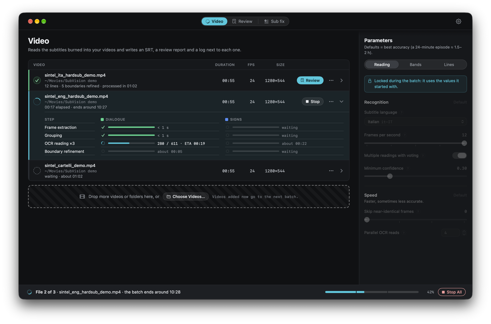
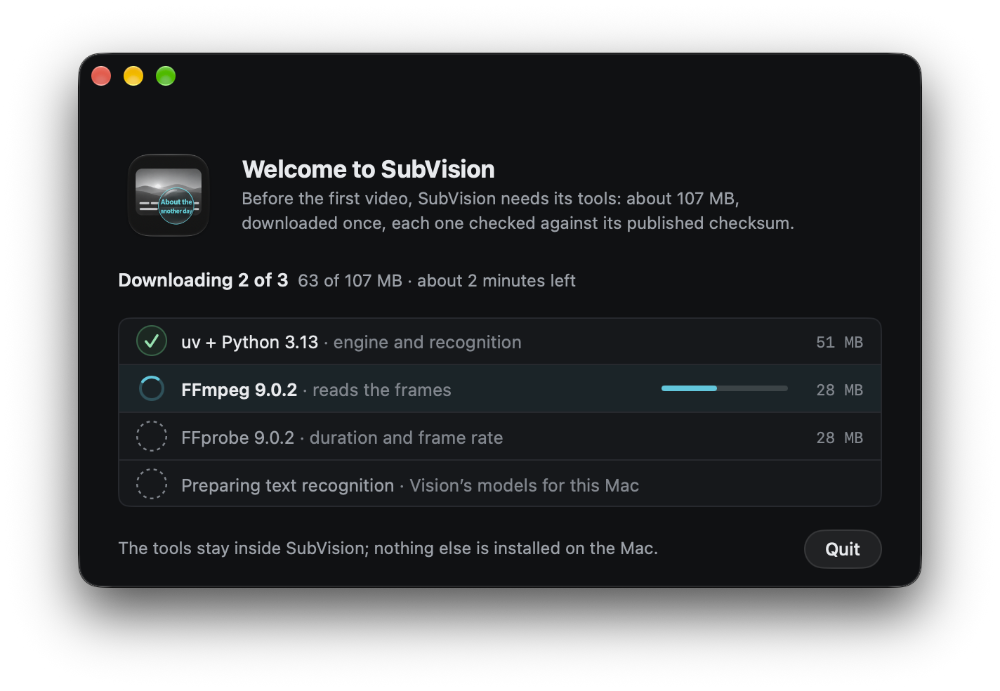
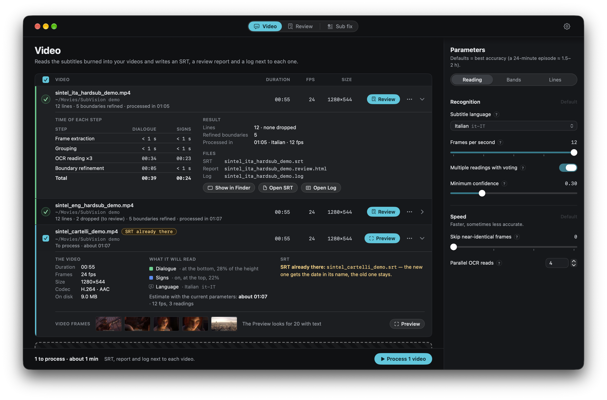
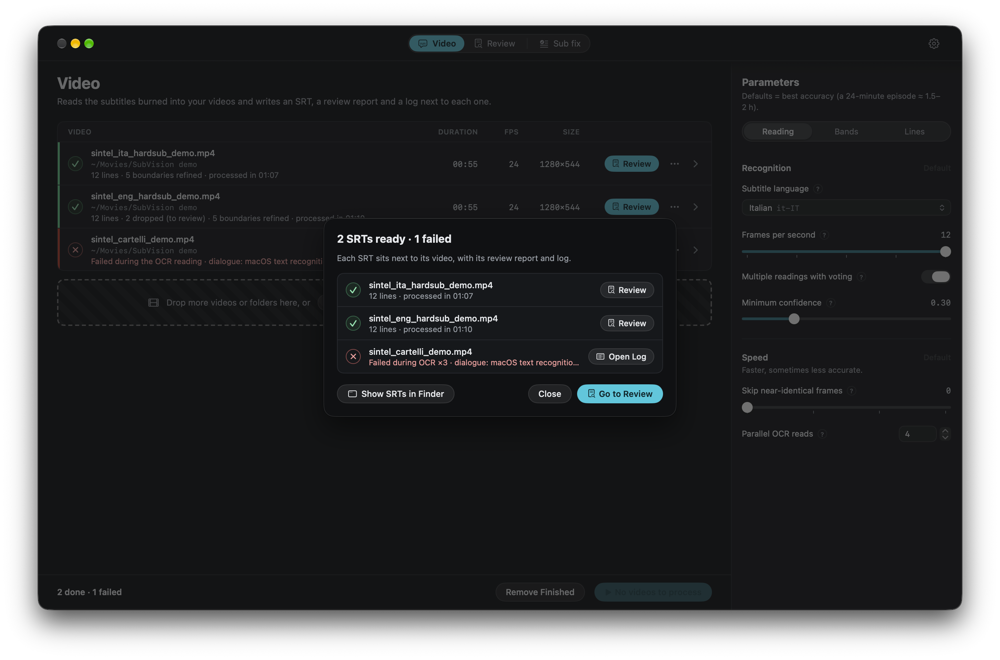
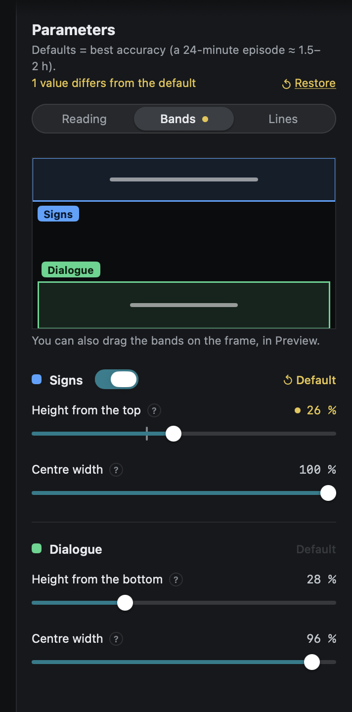
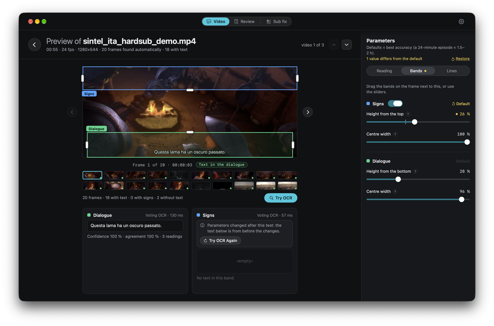
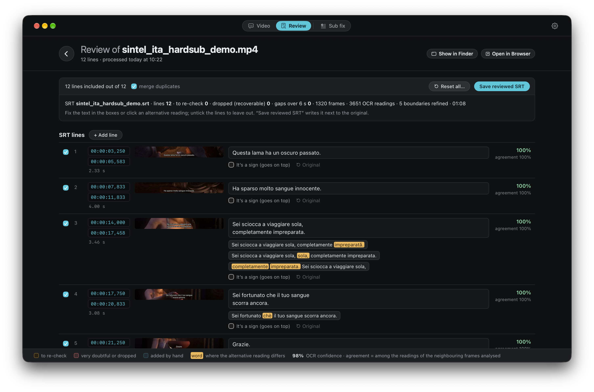
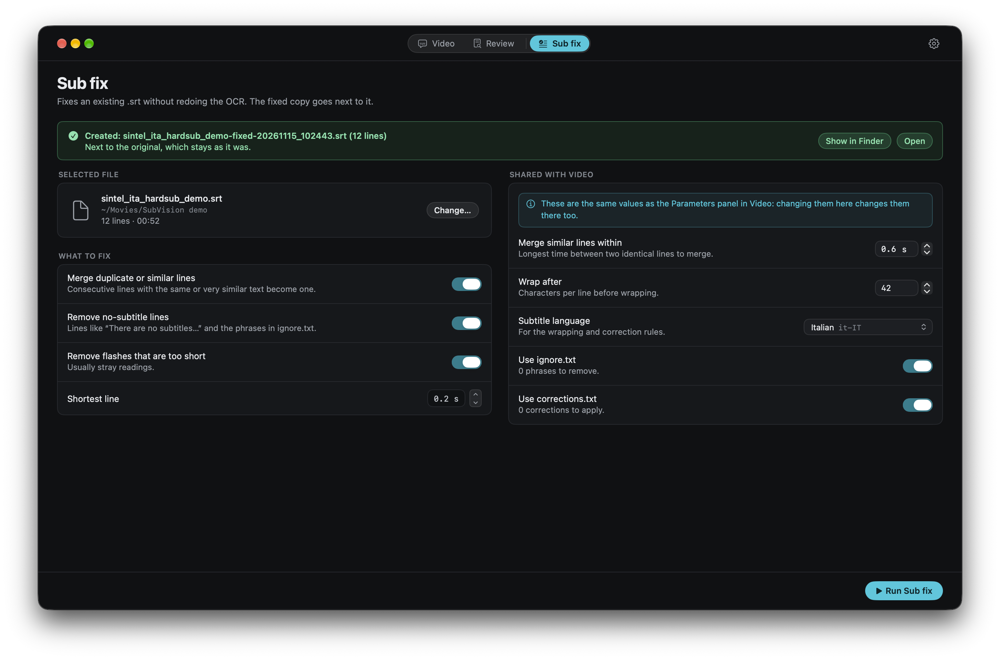
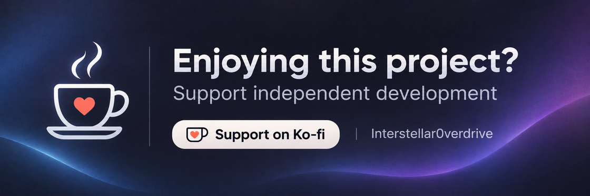

# SubVision

<picture>
  <source media="(prefers-color-scheme: dark)" srcset="https://raw.githubusercontent.com/Interstellar0verdrive/SubVision/assets/screenshots/2.0/icon_dark_256.png">
  <source media="(prefers-color-scheme: light)" srcset="https://raw.githubusercontent.com/Interstellar0verdrive/SubVision/assets/screenshots/2.0/icon_256.png">
  
</picture>

🇬🇧 English | [🇮🇹 Italiano](README.it.md)


[](https://github.com/Interstellar0verdrive/SubVision/releases/latest)

**Extract burned-in subtitles from your videos into clean SRT files, with
Apple's own OCR. A native Mac app: fast, offline, no hallucinations.**

SubVision reads the subtitles pressed into the frames of a video (hardsubs)
and turns them into a proper `.srt`, with a review report next to it where I
check and fix the few lines the OCR wasn't sure about. It is built for
**accuracy first**: the defaults always favour quality over speed, so there is
as little to fix by hand as possible.

<picture>
  <source media="(prefers-color-scheme: dark)" srcset="https://raw.githubusercontent.com/Interstellar0verdrive/SubVision/assets/screenshots/2.0/video_dark_en.webp">
  <source media="(prefers-color-scheme: light)" srcset="https://raw.githubusercontent.com/Interstellar0verdrive/SubVision/assets/screenshots/2.0/video_light_en.webp">
  
</picture>

Why Apple Vision instead of an LLM or a vision-language model:

- **It doesn't hallucinate.** It reads the glyphs that are there; if there is
  no text, it returns nothing.
- **It's fast.** It runs on the Neural Engine, about 18 frames a second, many
  times faster than a VLM.
- **It's deterministic and fully offline.** Your videos never leave the Mac.

SubVision 2.0 is a native macOS app written in SwiftUI. Version 1.x was a
Python program with a browser interface: that interface is gone,
and the engine that reads the subtitles now runs inside the app. What changed
is in the [release notes](https://github.com/Interstellar0verdrive/SubVision/releases/tag/v2.0.0)
and in the [changelog](CHANGELOG.md).

The app is in English and Italian, light or dark (Settings › General).

## Requirements

- A Mac with **Apple Silicon** (M1 or later).
- **macOS 26** (Tahoe) or later.
- An internet connection **on the first launch only**: SubVision downloads
  Python and its video tools (about 107 MB), then works offline.
- Nothing else. You don't need Python, Homebrew or FFmpeg beforehand.

On an Intel Mac or an older macOS, SubVision 1.0.0 is still available from
its [release page](https://github.com/Interstellar0verdrive/SubVision/releases/tag/v1.0.0).

## Install and first launch

1. Download `SubVision-v2.0.0-macos-app.zip` from the
   [latest release](https://github.com/Interstellar0verdrive/SubVision/releases/latest),
   unzip it and **drag `SubVision.app` into your Applications folder**.
2. Open it. The first time, macOS refuses, because SubVision has an ad hoc
   signature only: it isn't signed with an Apple Developer ID nor notarized.
   Open **System Settings › Privacy & Security**, scroll down to the message
   about SubVision, click **Open Anyway** and confirm. You only do this once.

   If you prefer the Terminal, removing the quarantine flag that macOS puts
   on downloaded files has the same effect:

   ```bash
   xattr -dr com.apple.quarantine /Applications/SubVision.app
   ```

3. A window lists what SubVision prepares before the first video, each with
   its own progress:

   | Row | What it is |
   |---|---|
   | **uv + Python 3.13** | the private Python environment of the engine, made with [uv](https://github.com/astral-sh/uv) |
   | **FFmpeg 9.0.2** | reads the frames of the video |
   | **FFprobe 9.0.2** | reads the duration and the frame rate |
   | **Preparing text recognition** | Vision prepares its models for this Mac: about 30 seconds, once for each version of macOS |

   Every download comes from a pinned release and is checked against its
   checksum (SHA256) before it is used; a damaged file is set aside and
   downloaded again. If the connection drops, **Try Again** picks up where it
   stopped. If you quit during the preparation of text recognition, it starts
   again at the next launch.

After that, SubVision opens straight on the Video page and works offline.

<picture>
  <source media="(prefers-color-scheme: dark)" srcset="https://raw.githubusercontent.com/Interstellar0verdrive/SubVision/assets/screenshots/2.0/first_launch_dark_en.png">
  <source media="(prefers-color-scheme: light)" srcset="https://raw.githubusercontent.com/Interstellar0verdrive/SubVision/assets/screenshots/2.0/first_launch_light_en.png">
  
</picture>

### Where SubVision keeps its things

Everything SubVision downloads stays in one folder; nothing else is installed
on the Mac:

| In `~/Library/Application Support/SubVision` | What it is |
|---|---|
| `bin/` | uv, and the downloaded `ffmpeg` and `ffprobe` |
| `.python/`, `.venv/`, `.cache/` | Python, the engine's packages and their caches |
| `ignore.txt`, `corrections.txt` | your two lists (see [Lists](#lists-ignoretxt-and-correctionstxt)) |
| `records/` | the logs of the app and of the engine, and the list of your videos |
| `tmp/` | work folders of the batch (removed when a file is done), the frames of the Preview and the small frames shown in the list |

The outputs never go there: they go next to your videos.

## How it works

The window has three pages, **Video**, **Review** and **Sub fix**, as tabs in
the bar at the top (⌘1 ⌘2 ⌘3). The Preview opens inside the Video page, and
the review report inside the Review page, each with a way back to its
list.

1. **Add your videos** to the Video page: drop files or whole folders on the
   window, or click **Choose Videos…** (⌘O). Subfolders are included; anything
   that isn't a video is skipped, with a note that says what was left out.
   New videos come in checked, ready to process.
2. **Check the bands** in the **Preview** (the **Preview** button of a row, or
   ⌘Y): it finds 20 frames with text by itself; drag the two bands on a frame
   until the subtitles fall inside, and try the OCR on that frame.
3. **Process** (⌘↩): the button at the bottom says what it will do, such as
   **Process 2 videos**. Each file shows its steps as it runs, with speed and
   time left.
4. **Review**: the **Review** button of a finished row opens its report on
   the Review page, where I check the doubtful lines and save the reviewed
   SRT.

### Video

<picture>
  <source media="(prefers-color-scheme: dark)" srcset="https://raw.githubusercontent.com/Interstellar0verdrive/SubVision/assets/screenshots/2.0/video_rows_dark_en.webp">
  <source media="(prefers-color-scheme: light)" srcset="https://raw.githubusercontent.com/Interstellar0verdrive/SubVision/assets/screenshots/2.0/video_rows_light_en.webp">
  
</picture>

- **The list of your videos**, with duration, frame rate and size, kept
  between launches. The strip under the list takes more videos at any time;
  videos added during a batch go to the next one.
- **One checkbox per row: to process.** New videos come in checked. The
  checkbox in the header checks or unchecks all the videos to process at
  once, and shows a **−** when only some are checked. A finished video shows
  its outcome instead; check it and it is marked **will be redone** (the new
  SRT gets the date in its name, the old one stays). A file that can't be read
  or isn't there any more has no checkbox and stays out of the batch.
- **Click a row to open it.** A finished video shows the time of each step
  for the dialogue and the signs, its result (lines, lines dropped, refined
  boundaries, gaps without subtitles) and its files, with **Show in Finder**,
  **Open SRT** and **Open Log**. A video still to process shows what is known
  before starting: the video itself (duration, frame rate, size, codecs, size
  on disk), what it will read (the two bands and the language), an estimate
  with the current parameters, an SRT already next to it (in yellow: the new
  one gets the date in its name) and five frames of the video, which become
  the Preview's 20 once it has looked for them. A failed or stopped file says
  what happened and at which step.
- **One main action per row**: **Preview**, **Review** or **Retry**, and
  **Stop** on the row in progress. The **⋯** menu holds everything else, and
  it is the same as the right-click menu.
- **The keyboard works on the list**: ↑ ↓ move the focus from row to row,
  Space or → opens a row and ← closes it, ⌫ removes it from the list (⌘Z puts
  it back), ⌘A checks every video.
- **Process** (⌘↩) runs the checked videos, one file at a time; next to the
  button, how many there are and about how long they will take (the estimate
  learns from the files already done). The row in progress opens by itself
  and shows its steps, for the dialogue band and, when it is on, the signs
  band: **Frame extraction** (with FFmpeg), **Grouping** (frames that repeat
  the previous one aren't read twice), **OCR reading** (each frame read three
  times, with voting) and **Boundary refinement** (start and end of each line
  moved to the video's own frames). The step in progress shows how far it is,
  its time left and its speed.
- **The batch bar** sits at the bottom of every page while a batch runs, and
  the Video tab spins: **File 2 of 3**, the name of the file and when the
  batch should end, a bar with one segment per file, as wide as its
  duration, the percentage and **Stop All**. Clicking the text shows the file
  in progress on the Video page.
- **Stop the current file** (⌥⌘., or **Stop** on its row) or **Stop All**
  (⌘.), each with a confirmation. A stopped file never leaves a half-written
  SRT, and the batch goes on with the next one; after Stop All, the videos
  that didn't start stay checked for the next batch.
- **The outcome stays on each row**: done with its number of lines, done but
  with no subtitles found, failed (at which step, and why, with its log one
  click away) or stopped by you. **Retry** processes a failed or stopped file
  again at once; during a batch it queues it instead (**Queued, after the
  batch**), and it starts by itself when the batch ends.
- **At the end of the batch** a sheet appears over whatever page is open: the
  SRTs made, with **Review** for each file, the files that failed with their
  reason and their log, **Show SRTs in Finder** and **Go to Review**. The Dock
  icon shows the progress of the batch while it runs, and macOS notifications
  tell you when files and the batch are done (both can be turned off in
  Settings › General).
- **Closing the window doesn't stop the batch**: it goes on, with its progress
  on the Dock icon, and clicking the icon brings the window back. **⌘Q** asks
  first, then stops the batch; the SRTs already made stay.

<picture>
  <source media="(prefers-color-scheme: dark)" srcset="https://raw.githubusercontent.com/Interstellar0verdrive/SubVision/assets/screenshots/2.0/video_finished_dark_en.webp">
  <source media="(prefers-color-scheme: light)" srcset="https://raw.githubusercontent.com/Interstellar0verdrive/SubVision/assets/screenshots/2.0/video_finished_light_en.webp">
  
</picture>

### The Parameters panel

<picture>
  <source media="(prefers-color-scheme: dark)" srcset="https://raw.githubusercontent.com/Interstellar0verdrive/SubVision/assets/screenshots/2.0/parameters_dark_en.webp">
  <source media="(prefers-color-scheme: light)" srcset="https://raw.githubusercontent.com/Interstellar0verdrive/SubVision/assets/screenshots/2.0/parameters_light_en.webp">
  
</picture>

On the right of the Video page, Preview included, the **Parameters** panel
is always open and holds every OCR setting, in three tabs: **Reading**,
**Bands** and **Lines**. The defaults aim at the best accuracy: a 24-minute
episode takes about 1.5–2 hours. Every value has a **(?)** with a full
explanation, and its default written under it. A value that differs from
its default is in yellow (amber in the light appearance), with a dot on its
tab, and a grey tick on the slider marks the default: click the tick to go
back to it. **↺ Restore** puts every value back to its default, and ⌘Z undoes
it. The values are kept between launches; while a batch runs the panel is
locked, in grey, because the batch uses the values it started with.

**Reading**

| Setting | Default | What it does |
|---|---|---|
| Subtitle language | the language of macOS, if Vision reads it; otherwise English | the language of the burned-in subtitles: it helps the OCR with accents and apostrophes. The menu lists the languages Vision reads on your Mac; Settings › General sets the default |
| Frames per second | 12 (4–12) | how many frames a second are read; lower is faster but may miss very short lines |
| Multiple readings with voting | on | each frame is read three times (Vision as is, Vision with more contrast, LiveText) and the reading with the most confidence-weighted votes wins; about three times the OCR time |
| Minimum confidence | 0.30 | text read with less confidence is ignored (it still ends up in the review report) |
| Skip near-identical frames | 0 (0–3) | 1 is about 20–30 % faster with the same timing; 2 or more is faster with less reliable boundaries |
| Parallel OCR reads | 4 (1–8) | doesn't change accuracy: the Neural Engine is the limit |

**Bands**

| Setting | Default | What it does |
|---|---|---|
| Signs band | on | a second pass on the top of the frame for signs and translator notes, written in the SRT with `{\an8}`; switching it off halves the time |
| Signs: height from the top | 22 % (5–50) | how much of the top of the frame is read |
| Signs: centre width | 100 % (50–100) | narrower keeps out watermarks in the top corners |
| Dialogue: height from the bottom | 28 % (5–80) | must hold two-line subtitles too |
| Dialogue: centre width | 96 % (50–100) | narrower keeps out corner logos but may cut long lines |

**Lines**

| Setting | Default | What it does |
|---|---|---|
| Shortest line | 0.20 s | shorter lines are dropped as flashes; the review report keeps them, ready to bring back |
| Merge similar lines within | 0.6 s | two lines with the same or similar text closer than this become one (fades) |
| Wrap lines at | 42 characters | longer lines are split into two or three balanced lines, preferably after punctuation, never after an article or a preposition, never inside a word |
| Refine timing to native frames | on | start and end recomputed at the video's own frame rate: about ±20 ms instead of ±40–120 ms |
| Review report | on | writes the review report next to the SRT; almost free |
| Flag gaps without subtitles over | 6 s | longer stretches without subtitles are listed in the report as possibly missed lines |
| Use ignore.txt | on | drops the phrases of your ignore list |
| Use corrections.txt | on | applies the replacements of your corrections list |

How long it takes, for a 20–24 minute episode on an Apple Silicon Mac:

| Profile | Settings | Time |
|---|---|---|
| **Defaults** (best accuracy) | 12 fps · skip 0 · multiple readings · signs band · refine | about 1.5–2 hours |
| Balanced | 8–10 fps · skip 1 · multiple readings · signs band only if needed | about 30–45 minutes |
| Fast (draft) | 6 fps · skip 1 · single reading · no signs band · no refine | about 5–15 minutes |

### Preview

<picture>
  <source media="(prefers-color-scheme: dark)" srcset="https://raw.githubusercontent.com/Interstellar0verdrive/SubVision/assets/screenshots/2.0/preview_dark_en.webp">
  <source media="(prefers-color-scheme: light)" srcset="https://raw.githubusercontent.com/Interstellar0verdrive/SubVision/assets/screenshots/2.0/preview_light_en.webp">
  
</picture>

The Preview is where I set the bands before a long batch. It opens inside
the Video page, over the list (the **Preview** button of a row, a frame in
an open row, or ⌘Y), with the Parameters panel beside it. Its title band
has **‹** to go back to the list (⌘[), **Preview of** and the name of the
video, with its duration, frame rate, size and frames found, and on the
right the arrows for the video above and below in the list (⌘↑ ⌘↓).

- **It finds 20 frames by itself** the first time you open a video: it splits
  the video into 20 zones and looks in each one for a frame with text (up to
  three tries per zone). The frames appear as they are found, and they are
  kept. If the search stops (you stopped it, a batch started, or part of the
  video can't be read), **Try Again** picks it up from the zones still
  missing. Each thumbnail says whether its frame has text in the dialogue
  band, in the signs band, in both or in neither.
- **The bands are drawn on the frame.** Drag the edge of a band for its
  height and its sides for its width (the width stays centred): the values
  are the same as in the Parameters panel, and change in both places.
- **Try OCR** (⌘T) reads that frame with the current parameters and shows,
  for each band, the text read, its confidence and agreement, the
  alternative readings and the final text as it would go in the SRT. The
  results stay with their frame while the app is open. If you change a
  parameter that matters after the test, the panel says so (the text below
  is from before the changes) and **Try OCR Again with the New Parameters**
  redoes it.
- During a batch the frame search and Try OCR wait for it to end.

### Review

<picture>
  <source media="(prefers-color-scheme: dark)" srcset="https://raw.githubusercontent.com/Interstellar0verdrive/SubVision/assets/screenshots/2.0/review_dark_en.webp">
  <source media="(prefers-color-scheme: light)" srcset="https://raw.githubusercontent.com/Interstellar0verdrive/SubVision/assets/screenshots/2.0/review_light_en.webp">
  
</picture>

The **Review** page lists the videos processed, with their lines, the gaps
without subtitles and when they were processed. A **Reviewed SRT** tag says
that a reviewed SRT is already next to the video, **review missing** that the
report isn't there any more. Click a row, or **Open**, and the video's
review report opens in the page, under a title band: **‹** goes back to the
list (⌘[), **Review of** and the name of the video with its lines, the lines
to re-check, the gaps and when it was processed, and on the right **Show in
Finder** and **Open in Browser**. Every **Review** in the app leads there:
the button of a row on the Video page, ⌘R, the end-of-batch sheet and the
notification of a finished file.

The review report is an editor, not just a report. In it:

- a bar that stays at the top while you scroll holds the lines included,
  **merge duplicates**, **Reset all…** (it asks first, and says what would be
  lost) and **Save reviewed SRT** (⌘S);
- every line has its frame, its start, end and duration, its confidence and
  the agreement between the readings; doubtful lines are highlighted, and a
  thin legend at the bottom of the page explains the colours;
- the text is **editable**, and **alternative readings** apply with one click,
  with the words that differ highlighted; **↺ Original** puts back what the
  OCR read, sign box included;
- **It's a sign (goes on top)**, under each line, writes it in the SRT at the
  top of the screen (with `{\an8}`);
- lines can be included or excluded, and the flashes and noise readings that
  were dropped (**Dropped**) can be **brought back**;
- **Gaps without subtitles** longer than the threshold of Parameters › Lines
  (6 s by default) are listed with a frame from the middle of each gap, and
  **+ Add a line here** adds one with its times already inside the gap;
  **+ Add line** adds one with empty times, to fill in. Lines added by hand
  have a **+** instead of their number, and next time they are in their
  place among the others;
- **Save reviewed SRT** writes `<video>-reviewed-<date>.srt` next to the
  original SRT, which stays as it was. If that folder can't be written to,
  the app offers **Choose Where to Save…**.

Your edits are saved as you go in `<video>.review.json`, next to the report:
leave the report, open it again, and they are still there. The report
follows the language of the app. It is also a plain HTML file: **Open in
Browser** opens it in your browser, where it works on its own, offline.
**File › Open a Review…** (⌥⌘O) opens any review report, including those
made by SubVision 1.x and by the first 2.0 builds: they are shown with the
current layout, in the language of the app, and the file itself is never
changed.

### Sub fix

<picture>
  <source media="(prefers-color-scheme: dark)" srcset="https://raw.githubusercontent.com/Interstellar0verdrive/SubVision/assets/screenshots/2.0/subfix_dark_en.webp">
  <source media="(prefers-color-scheme: light)" srcset="https://raw.githubusercontent.com/Interstellar0verdrive/SubVision/assets/screenshots/2.0/subfix_light_en.webp">
  
</picture>

**Sub fix** cleans an existing `.srt` **without redoing the OCR**, in a few
seconds. SRTs made by SubVision are already clean: Sub fix is for the ones
from elsewhere (old files, downloads, files edited by hand), or to apply new
`corrections.txt` rules to episodes already processed.

Drop an `.srt` on the page or choose it (**Choose SRT…**, ⇧⌘O), choose
what to fix (merge duplicate or similar lines, remove the lines without
subtitles and the phrases of `ignore.txt`, remove flashes shorter than a
minimum) and **Run Sub fix** (⌘↩). The fixed copy, `<name>-fixed-<date>.srt`, goes next to the
original, which stays as it was. The values shared with the Video page
(merge gap, line wrap, language, the two lists) are on the same page, and
changing them there changes them for Video too. Sub fix also works while a
batch runs, with the batch bar at the bottom (the shared values are locked
until it ends).

### The files SubVision writes

Everything goes next to the video. Nothing is ever overwritten.

| File | What it is |
|---|---|
| `<video>.srt` | the subtitles. If an SRT with that name is already there, the new one is `<video>_YYYYMMDD_HHMMSS.srt` (and so are its report and log) |
| `<video>.review.html` | the review report (unless it is switched off in Parameters › Lines) |
| `<video>.log` | the log of the file: every step, its time and its outcome |
| `<video>.review.json` | your edits in the review report, written by the app |
| `<video>-reviewed-YYYYMMDD-HHMM.srt` | the reviewed SRT, saved from the review report |
| `<name>-fixed-YYYYMMDD_HHMMSS.srt` | the copy made by Sub fix, next to its source |

### Lists: `ignore.txt` and `corrections.txt`

Two text files in SubVision's folder, edited from **Settings › Lists**
(**Edit…** opens them in your text editor):

- **`ignore.txt`**: phrases to drop, one per line, `#` for comments.
  Watermarks, fansub logos, fixed text on screen.
- **`corrections.txt`**: automatic replacements, one per line, in the form
  `wrong => right` (case-insensitive). It's the weapon for the typos the OCR
  will always make, like a name in an impossible font: one line such as
  `Flamilion => Hamilton` fixes every episode of the series. It applies to
  the batch, to Try OCR and to Sub fix.

**Import…** brings in a list you already have (it can replace the list or add
to the end of it); **Restore the Starter List…** goes back to the one
SubVision starts with.

### Settings

Settings (⌘,, or the gear at the right of the tab bar) has four tabs, with
the default written under each setting:

- **General**: the app's language (it starts in the language of macOS), the
  default subtitle language (the one the Parameters start from and go back
  to: the language of macOS if Vision reads it, otherwise English),
  appearance (System, Light, Dark), macOS notifications, progress on the
  Dock icon.
- **Tools**: which FFmpeg and FFprobe to use: the downloaded ones (default),
  the ones from Homebrew when it has both, or **A folder of mine…** with both
  inside; **Download Again**; the versions of the engine and of Python, and
  the languages Vision reads on this Mac.
- **Lists**: `ignore.txt` and `corrections.txt` (see above).
- **Updates**: SubVision checks GitHub for a new release at launch, at most
  once a day. When there is one, a **SubVision 2.x available** capsule
  appears in the tab bar, next to the gear, and opens the release page. You
  can turn the check off, or check now (also from the SubVision menu).

Tools and Lists are locked while a batch runs: the batch uses the tools and
lists it started with.

### Menus and shortcuts

| Shortcut | Action |
|---|---|
| ⌘O | Choose Videos… (adds them to the list) |
| ⇧⌘O | Choose SRT… (Sub fix) |
| ⌥⌘O | Open a Review… |
| ⌘↩ | Process the checked videos (on Video) · Run Sub fix (on Sub fix) |
| ⌥⌘. / ⌘. | Stop the Current File / Stop All |
| ⌘R | Review the video with the focus |
| ⌘S | Save the reviewed SRT (with a report open) |
| ⇧⌘R | Show in Finder |
| ↑ ↓ · Space → ← | Move the focus in the list · open and close the row |
| ⌫ | Remove the row with the focus from the list (⌘Z puts it back) |
| ⌘A | Check every video (on Video) |
| ⌘Y | Open the video with the focus in the Preview |
| ⌘T, ⌘← ⌘→ | Try OCR, previous and next frame (in the Preview) |
| ⌘↑ ⌘↓ | Previous and next video (in the Preview) |
| ⌘[ | Back to the list, from the Preview or a report |
| ⌘1 ⌘2 ⌘3 | Video, Review, Sub fix |
| ⌘0 | Bring back the main window |
| ⌘, | Settings |
| ⌥⌘L | Open the app's log in Console |

Every shortcut is also in the menus. The **SubVision** menu holds the
version (About SubVision), **Check for Updates…** and **SubVision on
GitHub**.

The window opens at least 1360 × 860 pt (almost the whole screen, on a
smaller one), so the list and the Parameters panel fit side by side. It can
be made narrower: below 1100 pt the panel retracts to a button in the top
bar, and opens over the page (⌥⌘I).

## Demo (Sintel)

The demo uses a 55-second dialogue clip from
[Sintel](https://durian.blender.org), the Blender Foundation open movie
(CC-BY 3.0, **© copyright Blender Foundation | durian.blender.org**), with
Italian and English subtitles burned in. To keep the repository light, the
demo files are attached to the
[Demo material release](https://github.com/Interstellar0verdrive/SubVision/releases/tag/demo-assets):

| File | What it is |
| --- | --- |
| [`sintel_ita_hardsub_demo.mp4`](https://github.com/Interstellar0verdrive/SubVision/releases/download/demo-assets/sintel_ita_hardsub_demo.mp4) / [`sintel_eng_hardsub_demo.mp4`](https://github.com/Interstellar0verdrive/SubVision/releases/download/demo-assets/sintel_eng_hardsub_demo.mp4) | 55 s clips with burned-in subtitles (IT / EN), about 9 MB each |
| [`sintel_ita_hardsub_demo.srt`](https://github.com/Interstellar0verdrive/SubVision/releases/download/demo-assets/sintel_ita_hardsub_demo.srt) / [`sintel_eng_hardsub_demo.srt`](https://github.com/Interstellar0verdrive/SubVision/releases/download/demo-assets/sintel_eng_hardsub_demo.srt) | the SRT extracted by SubVision |
| [`sintel_ita_hardsub_demo.revisione.html`](https://github.com/Interstellar0verdrive/SubVision/releases/download/demo-assets/sintel_ita_hardsub_demo.revisione.html) / [`sintel_eng_hardsub_demo.revisione.html`](https://github.com/Interstellar0verdrive/SubVision/releases/download/demo-assets/sintel_eng_hardsub_demo.revisione.html) | the review report of each run, made by SubVision 1.0 (open it in a browser, or in the app with File › Open a Review…) |

**Accuracy measured on the demo** with a fast profile (6 fps, skip 1, no
timing refinement, no signs band; about 20 seconds per clip):

- Italian clip: **12 of 12 subtitle lines found**, text **character for
  character identical** to Sintel's official SRT. SubVision 2.0 writes the
  very same SRT, byte for byte, as the one in the release.
- English clip: **12 of 12 lines found**, text identical to the official SRT.
- Timing within about ±0.1 s of the official subtitles even in this fast
  profile; the defaults also refine the boundaries to the native frame rate
  (about ±20 ms).

To try it yourself: download a clip, drop it on the Video page, set the
Parameters as above (Reading: 6 frames per second, skip 1; Bands: signs off;
Lines: refine off) and press **Process 1 video**. For the English clip,
choose English as the subtitle language.

## How the accuracy is built

1. **Multiple readings with voting.** Every frame is read three times: Vision
   as is, Vision with more contrast, and **LiveText**, Apple's second,
   independent OCR engine, which makes different mistakes. The text with the
   most confidence-weighted votes wins.
2. **Voting per line.** The final text of a line is the one that won across
   all the frames where it was visible (dozens of readings), not a single
   read.
3. **Timing refinement.** Start and end are recomputed at the video's native
   frame rate.
4. **Signs band.** An optional second pass on the top of the frame, written
   with `{\an8}` (top position).
5. **The review report.** Every doubtful line is easy to find and fix, with
   the alternative readings one click away.

Under the hood: FFmpeg extracts the frames of each band as they are (no fixed
filters: measured, they made the OCR worse); near-identical frames can be
skipped; Vision reads each frame in its variants and votes; the readings are
cleaned (junk, `ignore.txt`, graphic noise) and grouped into lines with a vote
per line, with fades merged; the boundaries are refined; the SRT and the
report are written.

## Command line

The engine is also a command-line program, `subvision`, the same engine the
app runs. It's mostly a test bench, so this section is all its documentation.
Inside the app it is at `SubVision.app/Contents/Resources/SubVision/subvision`:

```bash
SV="/Applications/SubVision.app/Contents/Resources/SubVision/subvision"
"$SV" extract ~/Movies/ep01.mkv ~/Movies/ep02.mkv   # SRT + review report + log next to each video
"$SV" extract clip.mp4 --lang en-US --fps 6 --skip-hamming 1 --no-refine --no-top
"$SV" fix old.srt                                   # Sub fix: writes old-fixed-<date>.srt
"$SV" preview ep01.mkv --n 20                       # sample frames, and which ones have text
"$SV" extract --help                                # every option
```

- `extract` takes the same parameters as the panel, with the same defaults:
  `--lang`, `--fps`, `--skip-hamming`, `--no-multi`, `--no-refine`,
  `--min-conf`, `--min-duration`, `--merge-gap`, `--wrap`, `--workers`,
  `--gap-warn`, `--no-report`, `--bottom-pct`, `--bottom-width`, `--no-top`,
  `--top-pct`, `--top-width`, `--no-ignore`, `--no-corrections`, and
  `--log-lang en|it` for the language of the log. `--lang` takes a language
  name or a BCP-47 code (default: Italian).
- `fix` takes `--no-merge`, `--no-ignore`, `--no-flash`, `--min-dur`,
  `--merge-gap`, `--wrap`, `--lang`, `--no-corrections`.
- It shares the folder of the app (`~/Library/Application Support/SubVision`):
  same Python, same lists. Progress goes to stderr, the files written to
  stdout. Exit status 1 when a file failed, 2 on an error.
- FFmpeg: `--ffmpeg PATH` (FFprobe is looked for next to it), then
  `$SUBVISION_FFMPEG`, then the ones the app downloaded, then the `PATH`. The
  command line doesn't download FFmpeg by itself: open the app once, or point
  it to one.
- `subvision serve` is the engine process the app talks to; it isn't meant
  to be used by hand.

### From source

```bash
git clone https://github.com/Interstellar0verdrive/SubVision.git
cd SubVision
SUBVISION_STATO="$HOME/SubVision-dev-state" ./subvision extract video.mkv --ffmpeg /opt/homebrew/bin/ffmpeg
tools/build_native.sh        # builds dist/SubVision-v<version>-macos-app.zip and its .sha256 (needs Xcode)
```

The launcher downloads uv (pinned version, checked by SHA256), then uv sets up
Python 3.13 and the packages pinned in `uv.lock`. `SUBVISION_STATO` keeps the
environment of a source checkout apart from the app's. The app is in
`macos/Native/`, the engine in `src/subvision/`, its tests in `tests/`.

## What's gone since 1.x

- **The browser interface** (Streamlit), `run.command`, `requirements.txt`
  and the `./videos` folder: videos stay where they are, and you add them to
  the list.
- **macOS 10.15–15 and Intel Macs.** 2.0 needs macOS 26 and Apple Silicon.
  1.0.0 stays available for older Macs.
- **Installing Python and FFmpeg yourself**: the app downloads and checks
  them. A Homebrew FFmpeg can still be used (Settings › Tools).
- **The free-text OCR language field**, which with an unknown language gave an
  empty SRT without an error: now the menu lists the languages Vision reads on
  your Mac, and a language it doesn't have is caught before the batch starts.
- **"Clear /tmp"**: the work folders are always removed when a file is done.
- **`.ui_prefs.json`**: settings are kept by the app.
- **Uploading an SRT in Sub fix**: drop it or open it.
- **The Python one-liner** with `import ocr_core`: use the command line.
- **Some file names**, now in English: the review report is
  `.review.html` (was `.revisione.html`), the reviewed SRT
  `-reviewed-<date>.srt` (was `-revisionato-`), the corrections list
  `corrections.txt` (was `correzioni.txt`).

## Coming from 1.x

- 2.0 is a separate app and **starts fresh**: it doesn't read the settings or
  the folders of 1.x. Your 1.x folder isn't touched; delete it when you no
  longer need it.
- **Your lists**: in **Settings › Lists**, **Import…** your old `ignore.txt`
  and `correzioni.txt` (they become `ignore.txt` and `corrections.txt`, same
  format), replacing the starter lists or adding to them.
- **Your SRTs and review reports** stay where they are. The app opens 1.x
  reports too (File › Open a Review…), with the current layout; the file
  stays as it was. Edits you made to a 1.x report in a
  browser stay in that browser.
- The parameters start from the defaults: set them again in the Parameters
  panel if you had changed them.

## Privacy

SubVision works on your Mac only. The OCR runs on Apple's Vision and LiveText
frameworks, locally; your videos, subtitles and reports never leave the Mac.
The only network traffic is:

- on the first launch (and when you choose **Download Again**): uv from
  GitHub, Python from its official builds via uv, the engine's packages from
  PyPI (pinned in `uv.lock`), FFmpeg and FFprobe from
  [Martin Riedl's macOS builds](https://ffmpeg.martin-riedl.de); each one
  pinned and checked by SHA256;
- the update check: one request to the GitHub API at launch, at most once a
  day, which you can turn off in Settings › Updates.

There is no telemetry and no account.

## Uninstalling

Quit SubVision (⌘Q), then delete `SubVision.app` from Applications and its
folder `~/Library/Application Support/SubVision` (in Finder: **Go › Go to
Folder…**, ⇧⌘G). Or, in the Terminal:

```bash
rm -rf /Applications/SubVision.app "$HOME/Library/Application Support/SubVision"
defaults delete io.github.interstellar0verdrive.subvision   # the app's settings
```

Your videos, and the SRTs, reports and logs next to them, are left alone.

## How it was made

SubVision 2.0 was written with the assistance of AI coding tools, with me in
the lead: I decided what the app does and how it looks, made every call along
the way, and tested it thoroughly on my own videos before releasing it.

## Credits

SubVision stands on the shoulders of these projects. None of them is in this
repository: they are downloaded on the first launch.

| Component | Used for | License |
|---|---|---|
| [ocrmac](https://github.com/straussmaximilian/ocrmac) | **the key enabler**: a thin Python wrapper around Apple's Vision and LiveText, which makes the native, offline OCR of macOS usable from Python | MIT |
| [PyObjC](https://github.com/ronaldoussoren/pyobjc) | the bridge between Python and Apple's frameworks, under ocrmac | MIT |
| [Pillow](https://github.com/python-pillow/Pillow) | image handling and the OCR variants | MIT-CMU |
| [FFmpeg](https://ffmpeg.org) 9.0.2, static macOS build by [Martin Riedl](https://ffmpeg.martin-riedl.de) | frame extraction, duration and frame rate. Downloaded on first launch and run as a separate program, never bundled | GPLv3 (this build) |
| [uv](https://github.com/astral-sh/uv) by Astral | the private Python environment | MIT / Apache-2.0 |
| [Python](https://www.python.org) 3.13, [python-build-standalone](https://github.com/astral-sh/python-build-standalone) | runs the engine | PSF |
| Apple **Vision** and **LiveText** | the OCR engines themselves, part of macOS | — |

## License

[MIT](LICENSE) © 2026 Interstellar0verdrive.

Demo videos: clips from *Sintel*, the Blender Foundation open movie —
**© copyright Blender Foundation | durian.blender.org** — licensed under
[CC-BY 3.0](https://creativecommons.org/licenses/by/3.0/).

---

<p align="center">
<a href="https://ko-fi.com/Interstellar0verdrive">
<picture>
  <source media="(prefers-color-scheme: dark)" srcset="https://raw.githubusercontent.com/Interstellar0verdrive/SubVision/assets/screenshots/2.0/support_kofi_dark_en.webp">
  <source media="(prefers-color-scheme: light)" srcset="https://raw.githubusercontent.com/Interstellar0verdrive/SubVision/assets/screenshots/2.0/support_kofi_light_en.webp">
  
</picture>
</a>
</p>
